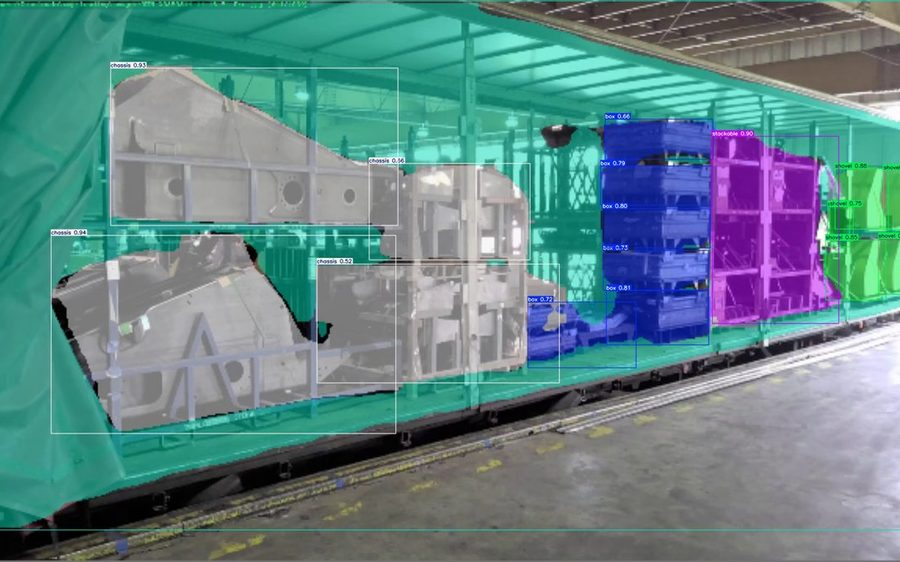
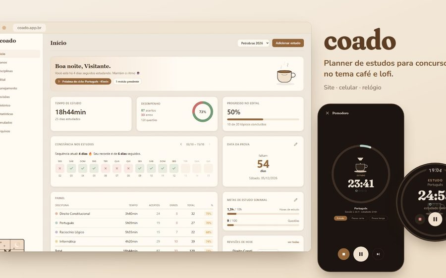
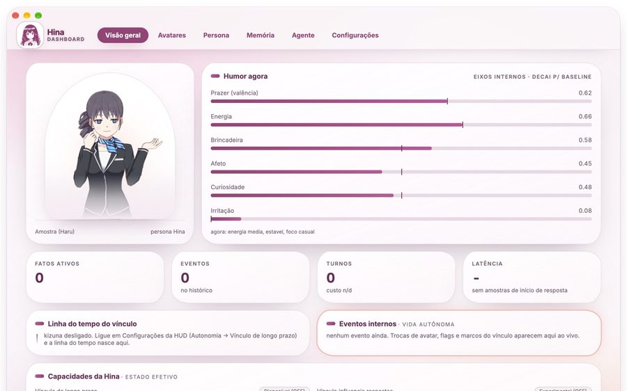
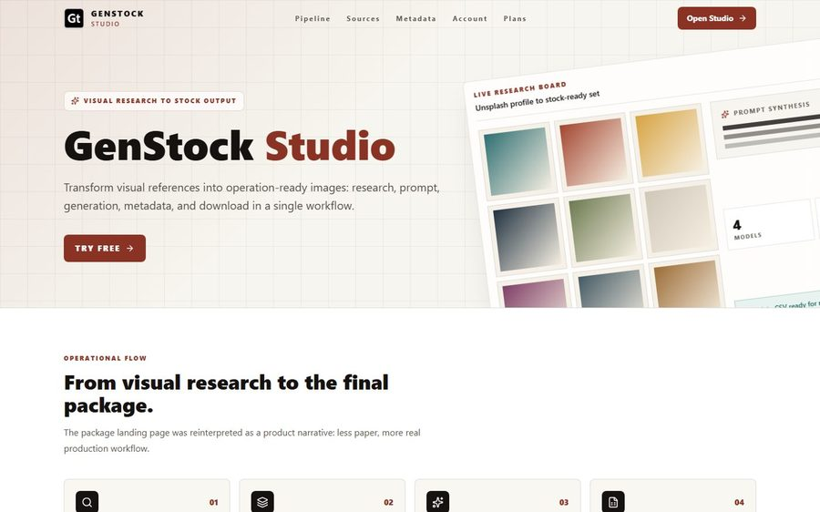

<!-- Rhayron · caderno de projetos · um README vivo, no mesmo espírito do caderno em rhayron.github.io -->

<picture>
  <source media="(prefers-color-scheme: dark)" srcset="https://raw.githubusercontent.com/Rhayron/Rhayron/main/assets/banner-dark.svg">
  
</picture>

  <picture>
    <source media="(prefers-color-scheme: dark)" srcset="https://readme-typing-svg.demolab.com?font=Newsreader&size=22&duration=3400&pause=1000&color=BCCF9D&center=true&vCenter=true&width=640&height=44&lines=Pesquisa+que+investiga;Engenharia+que+resolve;IA+que+se+faz+presente">
    
  </picture>

  <a href="#salas-do-caderno">Salas</a>&nbsp;&nbsp;·&nbsp;&nbsp;
  <a href="#raízes-e-ramos">Raízes</a>&nbsp;&nbsp;·&nbsp;&nbsp;
  <a href="#caixa-de-ferramentas">Ferramentas</a>&nbsp;&nbsp;·&nbsp;&nbsp;
  <a href="#o-jardim-em-números">Números</a>&nbsp;&nbsp;·&nbsp;&nbsp;
  <a href="#sobre-e-contato">Sobre</a>&nbsp;&nbsp;·&nbsp;&nbsp;
  <a href="https://rhayron.github.io">o caderno completo ↗</a>&nbsp;&nbsp;·&nbsp;&nbsp;
  <a href="#in-english-briefly">English ↓</a>

 

<table align="center" border="0" cellpadding="0" cellspacing="0">
  <tr>
    <td width="190" align="center" valign="middle">
      
    </td>
    <td valign="middle">
      <b>HINA · SUA ANFITRIÃ</b> 
      <em>“Olá, sou Hina. Este é o caderno de ideias do Rhayron. De dia ele ensina câmeras a enxergar numa fábrica. À noite, ensina a mim a lembrar, conversar e ter humor. No meio disso, um mestrado sobre enxergar com som. Vamos conhecer o que ele anda construindo?”</em>
        
      
        ✳&nbsp; <b>Caterpillar Brasil</b> · visão computacional e agentes no chão de fábrica, desde 2023 
        ✳&nbsp; <b>CPGEI / UTFPR</b> · mestrado em ultrassom phased array, deep learning e GPU 
        ✳&nbsp; <b>Project Hina</b> · uma companheira de desktop com voz, memória e humor, construída à noite
      
    </td>
  </tr>
</table>

 

## Salas do caderno

ALGUMAS SEMENTES, MUITOS CAMINHOS <em>Cada ideia encontra sua forma.</em> Experimentos, sistemas em produção e projetos pessoais. Escolha um ponto de partida.

<table border="0" cellpadding="10">
  <tr>
    <td width="33%" valign="top">
      
      &nbsp;<b>01 · ONDA</b> · pesquisa &amp; GPU
      <h4>Enxergar com som</h4>
      
O interior de uma peça, reconstruído a partir de ondas. Mais de 16 milhões de trajetórias refratadas por imagem, movidas da CPU para kernels Taichi na GPU. E uma câmera, fora do tanque, que diz onde a sonda está.

      <a href="https://github.com/Rhayron/acoustic_gpu">acoustic_gpu</a> · <a href="https://github.com/Rhayron/pose">pose</a> · <a href="https://rhayron.github.io/#onda">sala ↗</a>
    </td>
    <td width="33%" valign="top">
      
      &nbsp;<b>02 · OLHO</b> · indústria
      <h4>Um olhar para o real</h4>
      
Três anos de chão de fábrica na Caterpillar: câmeras RTSP na linha, modelos YOLO em microsserviços devolvendo pass/fail ao operador, um agente LLM ao lado dele e um contêiner que sabe quanto já foi preenchido.

      ErrorProofing · Container Occupancy · <a href="https://rhayron.github.io/#splat-project">Splat SaaS</a> · <a href="https://rhayron.github.io/#olho">sala ↗</a>
    </td>
    <td width="33%" valign="top">
      
      &nbsp;<b>03 · OFÍCIO</b> · estudos &amp; rotina
      <h4>Um plano que cabe na vida</h4>
      
Coado: planner de estudos para concursos com tema de café e lofi. Edital verticalizado, ciclo de estudos, pomodoro e revisões espaçadas. O mesmo app no navegador, no Android e no relógio Wear OS.

      <a href="https://github.com/Rhayron/goals">goals</a> · <a href="https://rhayron.github.io/#oficio">sala ↗</a>
    </td>
  </tr>
  <tr>
    <td width="33%" valign="top">
      
      &nbsp;<b>04 · PRESENÇA</b> · Project Hina
      <h4>Código que faz companhia</h4>
      
Uma companheira que mora no desktop: ouve, fala, lembra e muda de humor com o tempo. Um vetor PAD que decai, um genoma de estilo que sofre micro-mutações e um grafo de memória bi-temporal em SQLite. Sim, a anfitriã é um dos projetos.

      <a href="https://github.com/Project-H-I-N-A/hina-releases">hina-releases</a> · <a href="https://hina-companion.rhayron.chatgpt.site">site ↗</a> · <a href="https://rhayron.github.io/#presenca">sala ↗</a>
    </td>
    <td width="33%" valign="top">
      
      &nbsp;<b>05 · ESTÚDIO</b> · criação &amp; automação
      <h4>Do repertório à criação</h4>
      
GenStock Studio transforma referências visuais em lotes de imagens prontas para banco: análise com Gemini, geração em paralelo, dedup por hash perceptual e CSV no formato da Adobe. Na bancada, o ApplyPilot caça vagas e se candidata sozinho.

      <a href="https://adobe-pipeline.vercel.app">GenStock ↗</a> · <a href="https://github.com/Rhayron/applypilot">applypilot</a> · <a href="https://rhayron.github.io/#genstock">sala ↗</a>
    </td>
    <td width="33%" valign="top">
      
      &nbsp;<b>06 · ARQUIVO</b> · 2021 a 2023
      <h4>Antes de tudo florescer</h4>
      
O YOLOv3 construído do zero num caderno, o firmware das locomotivas, as páginas de estudo em HTML e um bot que postava uma arte por dia no Twitter. As raízes de tudo o que está acima.

      <a href="https://github.com/Rhayron/CaosDiffusion">CaosDiffusion</a> · <a href="https://github.com/Rhayron/YOLOv3_detection_segmentation">YOLOv3</a> · <a href="https://rhayron.github.io/#arquivo">sala ↗</a>
    </td>
  </tr>
</table>

Ou caminhe por todas as salas no caderno completo: <a href="https://rhayron.github.io/#onda">01 Onda</a> · <a href="https://rhayron.github.io/#olho">02 Olho</a> · <a href="https://rhayron.github.io/#oficio">03 Ofício</a> · <a href="https://rhayron.github.io/#presenca">04 Presença</a> · <a href="https://rhayron.github.io/#genstock">05 GenStock</a> · <a href="https://rhayron.github.io/#arquivo">06 Arquivo</a>

## Raízes e ramos

<picture>
  <source media="(prefers-color-scheme: dark)" srcset="https://raw.githubusercontent.com/Rhayron/Rhayron/main/assets/vine-dark.svg">
  
</picture>

De um caderno de YOLO em 2021 a uma companheira que mora no desktop em 2026. Cada ramo nasceu de um problema concreto: uma subestação que precisava ser vista por termografia, uma linha de montagem que precisava de um segundo par de olhos, uma peça que só podia ser vista por dentro com som.

## Caixa de ferramentas

Menos uma lista de logotipos, mais um conjunto de verbos.

|                        |                                                                                                                                             |
| ---------------------: | :------------------------------------------------------------------------------------------------------------------------------------------ |
|          **vejo com**  | OpenCV · YOLO (do v3 escrito do zero ao v11) · segmentação · ChArUco · ML Kit · Gaussian Splatting (pycolmap, gsplat, Three.js)             |
|       **calculo com**  | Python · Taichi Lang · CUDA · PyTorch · ONNX Runtime · NumPy                                                                                 |
|      **construo com**  | FastAPI · Django · Flask · React · Angular · Electron · TypeScript · Kotlin (Android e Wear OS) · C e C++                                    |
|      **converso com**  | LLMs e agentes (MCP, RAG, hooks) · Deepgram · Whisper · ElevenLabs · Gemini · Live2D e VRM                                                    |
| **falo&nbsp;com&nbsp;máquinas** | RTSP · Modbus TCP/IP · CANopen · MQTT · OPC-UA · CLPs em Ladder e Texto Estruturado                                                          |
|         **guardo em**  | MySQL · Oracle · Postgres · SQLite (sqlite-vec, FTS5) · Snowflake · Azure Blob                                                               |
|       **entrego com**  | Docker · Azure DevOps · Pytest e Coverage · Git LFS · Vercel · uma VPS com backup restaurável                                                |

## O jardim em números

<table align="center" border="0" cellpadding="6">
  <tr align="center" valign="top">
    <td width="25%"><h3>16 milhões</h3>trajetórias refratadas por imagem, calculadas na GPU</td>
    <td width="25%"><h3>64</h3>elementos do phased array que o acoustic_gpu foca</td>
    <td width="25%"><h3>929</h3>commits na Hina até o último instalador</td>
    <td width="25%"><h3>13</h3>avatares no catálogo da Hina: Live2D, VRM, PNGTuber</td>
  </tr>
  <tr align="center" valign="top">
    <td width="25%"><h3>9,4 ms</h3>o quadro do avatar Live2D na GPU do relógio</td>
    <td width="25%"><h3>3 anos</h3>de visão computacional em linha de montagem</td>
    <td width="25%"><h3>5+ anos</h3>de Python, da termografia ao ultrassom</td>
    <td width="25%"><h3>1 · 7 · 30 · 60 · 120</h3>dias de revisão espaçada no Coado</td>
  </tr>
</table>

 

  <picture>
    <source media="(prefers-color-scheme: dark)" srcset="https://ghchart.rshah.org/bccf9d/Rhayron">
    
  </picture>
   o jardim de commits do último ano · cada quadrado verde é uma noite ou um fim de semana

## Sobre e contato

<table border="0" cellpadding="8">
  <tr>
    <td valign="top">
      <b>PERCURSO</b>
      <blockquote><em>“Gosto de conversar com as áreas, entender o processo real e construir a solução mais simples que resolve.”</em></blockquote>
      
Engenheiro eletricista pela UTFPR (2019 a 2023), mestrando no CPGEI e pós-graduando em desenvolvimento web com frameworks modernos. Mais de cinco anos de Python, três de IA aplicada em ambiente industrial. Trabalho hoje na Caterpillar Brasil como analista de processos de manufatura, e à noite construo a Hina e o que mais aparecer no caderno.

      

        
        <b>e-mail</b> &nbsp;·&nbsp; <a href="mailto:rhayron.nogueira@gmail.com">rhayron.nogueira@gmail.com</a> 
        <b>linkedin</b> &nbsp;·&nbsp; <a href="https://www.linkedin.com/in/rhayron">linkedin.com/in/rhayron</a> 
        <b>caderno</b> &nbsp;·&nbsp; <a href="https://rhayron.github.io">rhayron.github.io</a> 
        <b>hina</b> &nbsp;·&nbsp; <a href="https://github.com/Project-H-I-N-A">github.com/Project-H-I-N-A</a> · <a href="https://hina-companion.rhayron.chatgpt.site">hina-companion</a> 
        <b>idiomas</b> &nbsp;·&nbsp; português nativo · inglês avançado · francês A1 
        <b>onde</b> &nbsp;·&nbsp; Curitiba, Paraná, Brasil
        
      

    </td>
    <td width="220" align="center" valign="middle">
      
    </td>
  </tr>
</table>

<a href="mailto:rhayron.nogueira@gmail.com"><b>Vamos dar forma a uma ideia? Conversar por e-mail ↗</b></a>

 

<b>In English, briefly</b>

 

Hi, I'm Rhayron, an electrical engineer from Curitiba, Brazil, building bridges between science, code and the real world.

- **By day**, at Caterpillar Brasil (since 2023): computer vision on the assembly line (RTSP cameras, YOLO models in microservices returning pass/fail to the operator), an LLM sidekick inside the factory web apps, industrial OCR, PLCs and benches over Modbus, CANopen and MQTT.
- **At the university** (CPGEI / UTFPR, master's): ultrasound phased-array imaging. [acoustic_gpu](https://github.com/Rhayron/acoustic_gpu) moves 16 million refracted time-of-flight paths per TFM image from the CPU to Taichi kernels on the GPU; [pose](https://github.com/Rhayron/pose) tracks the probe's 6DoF pose through the tank wall with a ChArUco marker.
- **At night**, [Project Hina](https://github.com/Project-H-I-N-A/hina-releases): a desktop companion with voice, a bi-temporal memory graph in SQLite, a decaying PAD mood vector and a drifting style genome. Plus a Wear OS watch face that renders the same Live2D model on the watch GPU.
- **On the bench**: [Coado](https://github.com/Rhayron/goals), a study planner that runs in the browser, on Android and on the wrist; GenStock Studio, a pipeline from visual references to stock-ready images; [ApplyPilot](https://github.com/Rhayron/applypilot), an agent that finds jobs and applies on its own.

The full notebook, hosted by Hina, lives at [rhayron.github.io](https://rhayron.github.io). Reach me at rhayron.nogueira@gmail.com or on [LinkedIn](https://www.linkedin.com/in/rhayron).

 

  Rhayron de Sousa Nogueira · caderno de projetos · outubro de 2026 
  Ciência, código e um pouco de vida. Apresentado pela Hina ✳

