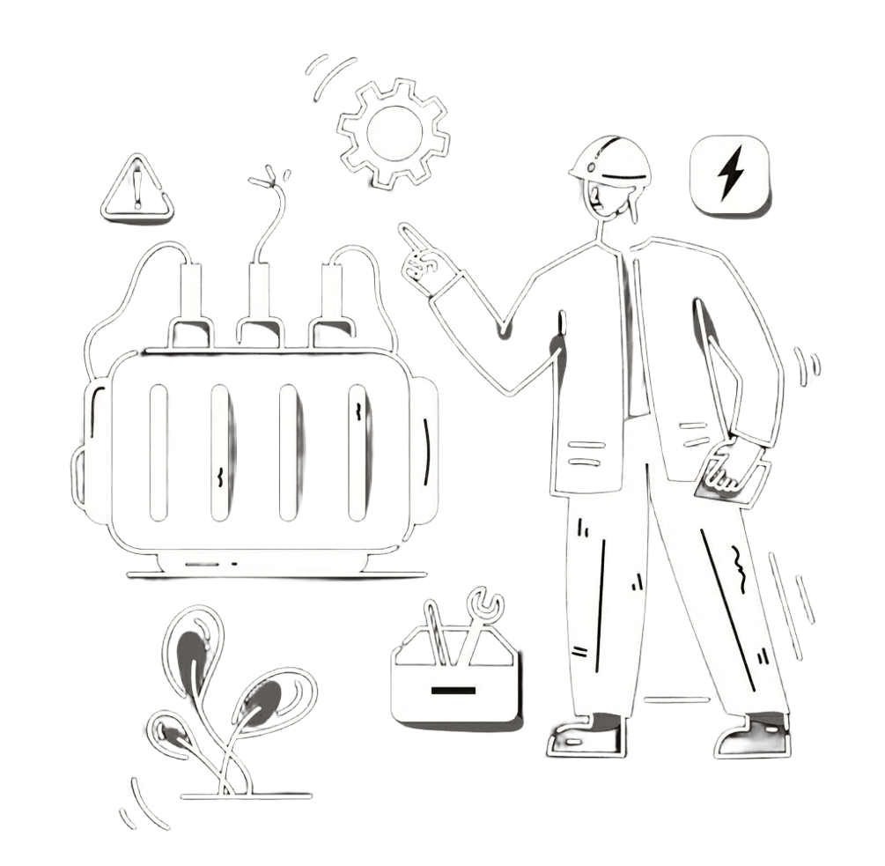
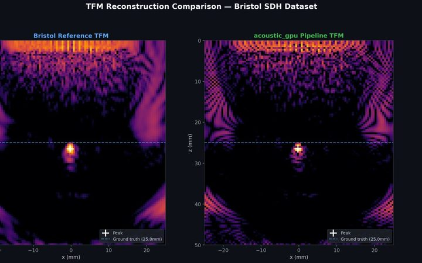
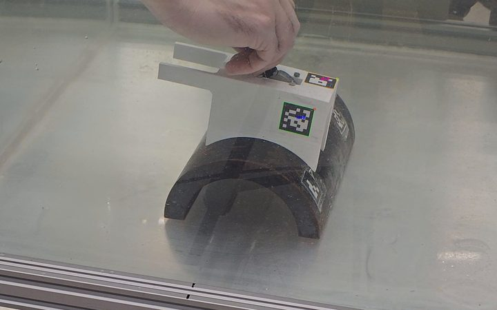
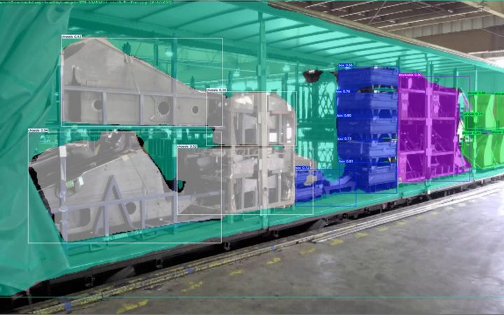
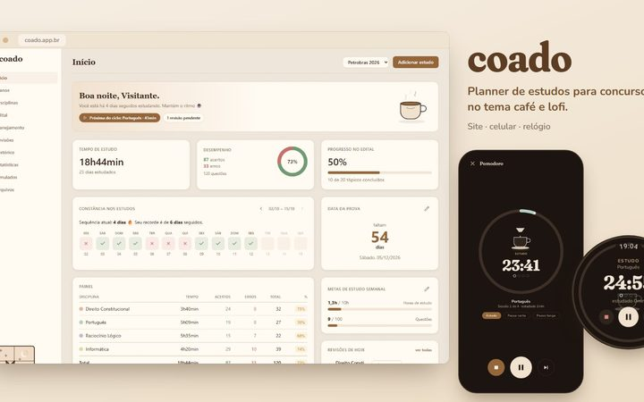
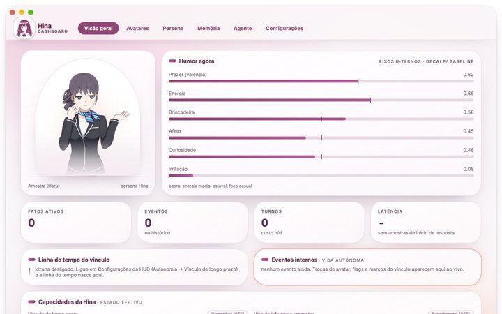

  

  <picture>
    <source media="(prefers-color-scheme: dark)" srcset="https://readme-typing-svg.demolab.com?font=Fira+Code&size=20&duration=3200&pause=900&color=BCCF9D&center=true&vCenter=true&width=720&height=42&lines=Ol%C3%A1%2C+eu+sou+o+Rhayron+%F0%9F%91%8B;Ensino+c%C3%A2meras+a+enxergar+numa+linha+de+montagem;Reconstruo+imagens+de+ultrassom+na+GPU;Construo+a+Hina%2C+uma+companheira+de+desktop;Sempre+aprendendo+algo+novo">
    
  </picture>

  
  
  
  
  

## 👋 Sobre mim

<ul>
  <li>🔭 <b>Hoje</b> sou analista de processos de manufatura na <b>Caterpillar Brasil</b>: visão computacional na linha de montagem, agentes LLM dentro das aplicações da fábrica e automação de bancadas e CLPs.</li>
  <li>🎓 <b>Mestrando</b> no CPGEI / UTFPR (conceito CAPES 6): modelo híbrido de deep learning com o método SEAM para imageamento ultrassônico de phased array. Engenheiro eletricista pela UTFPR, turma 2019 a 2023.</li>
  <li>🌙 <b>À noite</b> construo o <b>Project Hina</b>, uma companheira de desktop com voz, memória e humor, e o que mais aparecer no caderno.</li>
  <li>🌱 <b>Aprendendo agora</b>: Gaussian Splatting, Wear OS, Taichi Lang e modelos híbridos para ultrassom.</li>
  <li>💬 <b>Pergunte sobre</b>: YOLO em produção, RTSP e Modbus, TFM na GPU, Live2D, agentes com MCP.</li>
  <li>🗣️ <b>Idiomas</b>: português nativo · inglês avançado · francês A1.</li>
  <li>📫 <b>Contato</b>: <a href="mailto:rhayron.nogueira@gmail.com">rhayron.nogueira@gmail.com</a></li>
</ul>

<blockquote><em>“Gosto de conversar com as áreas, entender o processo real e construir a solução mais simples que resolve.”</em></blockquote>

 

## 🚀 Projetos em destaque

<table border="0" cellpadding="8">
  <tr>
    <td width="290" valign="top"></td>
    <td valign="top">
      <b><a href="https://github.com/Rhayron/acoustic_gpu">acoustic_gpu</a></b> &nbsp;pesquisa · fev. 2026 · público 
          
      Reconstrução TFM de ultrassom em ensaio por imersão. Para cada imagem são mais de <b>16 milhões de trajetórias refratadas</b> (64 elementos × 512 × 512 pixels), cada uma um problema de minimização. O módulo move o cálculo para kernels Taichi na GPU, mantém uma referência na CPU para validar e cobre superfícies planas, inclinadas, tubulares e irregulares estimadas dos próprios ecos. Validado no dataset FMC de Bristol.
    </td>
  </tr>
  <tr>
    <td width="290" valign="top"></td>
    <td valign="top">
      <b><a href="https://github.com/Rhayron/pose">pose</a></b> &nbsp;pesquisa · jul. a out. 2026 · público 
          
      Onde está a sonda? Uma câmera 4K no tripé, fora do tanque, enxerga pela parede de vidro um marcador preso ao transdutor dentro da água e devolve a <b>pose 6DoF</b> da sonda. Com ela, cada quadro de ultrassom ganha um lugar no espaço, para registro 3D em inspeção subaquática. Calibração intrínseca do Caliscope, vídeo cru no disco e a matriz K viajando no JSON da sessão.
    </td>
  </tr>
  <tr>
    <td width="290" valign="top"></td>
    <td valign="top">
      <b>ErrorProofing System</b> e <b>Container Occupancy</b> &nbsp;Caterpillar Brasil · 2023 em diante · privado 
            
      Inspeção visual da linha de montagem: lê os feeds RTSP das câmeras industriais, roda os modelos em microsserviços e devolve <b>pass/fail em tempo real</b> ao operador, cruzando com o torque das bancadas e os dados do MES em Oracle. Imagens de inferência no Azure Blob com rastreabilidade; Pytest e Coverage no Azure DevOps antes de cada versão ir para a linha. No Container Occupancy, uma webcam e um YOLOv10 de segmentação calculam o percentual de preenchimento do contêiner para a logística. Ao lado, um agente LLM com RAG responde dúvidas e executa tarefas dentro das aplicações da fábrica.
    </td>
  </tr>
  <tr>
    <td width="290" valign="top"></td>
    <td valign="top">
      <b>Splat SaaS</b> &nbsp;mai. 2026 · privado 
           
      De muitas imagens, um espaço para explorar. O FFmpeg extrai os quadros, o SfM com pycolmap estima as câmeras, Splatfacto e gsplat ajustam gaussianas na GPU e o pipeline exporta PLY para um visualizador WebGL no navegador. Etapas acompanhadas por SSE, prévia durante o treino pelo viewer Viser, autenticação em cookie httpOnly e planos Free e Pro com Stripe. A imagem é a cena pública de referência do Spark, usada para explorar a técnica.
    </td>
  </tr>
  <tr>
    <td width="290" valign="top"></td>
    <td valign="top">
      <b><a href="https://github.com/Rhayron/goals">Coado</a></b> &nbsp;out. 2026 · público 
            
      Planner de estudos para concursos com tema de café e lofi: edital verticalizado, ciclo de estudos, pomodoro, revisões espaçadas em 1, 7, 30, 60 e 120 dias, estatísticas e simulados. O mesmo app roda no navegador, no Android (login nativo com Google e pomodoro em segundo plano) e no relógio Wear OS, onde o timer são carimbos de tempo e alarmes exatos. Login por authorization code com PKCE, isolamento por conta até nas chaves estrangeiras e sincronização em lote com retry.
    </td>
  </tr>
  <tr>
    <td width="290" valign="top"></td>
    <td valign="top">
      <b><a href="https://github.com/Project-H-I-N-A/hina-releases">Project Hina</a></b> &nbsp;jun. 2026 em diante · 929 commits · instaladores públicos 
            
      VTuber companion e desktop pet. Janela Electron com modo pet transparente e click-through; conversa, voz e memória num servidor Python local por FastAPI e WebSocket. Ela ouve pelo microfone, responde em áudio, olha para o ponteiro e acompanha o rosto pela câmera. Com o modo agente, executa ferramentas via MCP (busca, arquivos, shell, lembretes, Kanban com workers), perguntando antes de escrever ou executar. Por dentro: um <b>vetor de humor PAD que decai</b> à linha de base da persona, um <b>genoma de estilo</b> em dez dimensões com micro-mutações, e um <b>grafo de memória bi-temporal</b> em SQLite com busca vetorial, FTS5 e recall híbrido. A família: <b>HinaWatch</b> (o mesmo modelo Live2D na GPU do relógio, de 17,5 para 9,4 ms por quadro), <b>HinaMobile</b> (o celular acha o rosto e manda só a posição ao relógio) e <b>hina2d</b> (a identidade Live2D própria). <a href="https://hina-companion.rhayron.chatgpt.site">Site e documentação ↗</a>
    </td>
  </tr>
  <tr>
    <td width="290" valign="top"></td>
    <td valign="top">
      <b><a href="https://adobe-pipeline.vercel.app">GenStock Studio</a></b> &nbsp;dez. 2025 a set. 2026 · 93 commits · no ar 
           
      Pipeline para produzir imagens de banco: coleta referências (Adobe Stock, Unsplash, Pixabay, Pexels), analisa cada uma com o Gemini e escreve prompts detalhados, gera novas imagens em paralelo com retry, remove duplicatas por hash perceptual, faz upscale, exporta o CSV de metadados no formato da Adobe e, se quiser, gera vídeo 4K com o Veo. A galeria atualiza por SSE enquanto o lote roda.
    </td>
  </tr>
  <tr>
    <td width="290" valign="top"></td>
    <td valign="top">
      <b>Arquivo</b> &nbsp;2021 a 2023 
         
      Onde tudo começou. <a href="https://github.com/Rhayron/CaosDiffusion">CaosDiffusion</a> sorteava um prompt, gerava uma arte por IA e postava no Twitter todo dia. Os cadernos de <a href="https://github.com/Rhayron/YOLOv3_detection_segmentation">detecção e segmentação com YOLOv3</a> explicam NMS, mAP e matriz de confusão, e antes deles veio um YOLOv3 construído do zero a partir do arquivo de configuração. No estágio na ART, firmware para computadores de bordo de locomotivas e automação de testes de hardware. Na UTFPR, análise automática de imagens termográficas de subestações para a Copel e o hardware de um veículo guiado automatizado.
    </td>
  </tr>
</table>

<b>🧰 Também na bancada</b> · ferramentas menores que nasceram de necessidades concretas

 

<table>
  <tr><th align="left">quando</th><th align="left">o quê</th><th align="left"></th></tr>
  <tr><td nowrap valign="top">out. 2026</td><td nowrap valign="top"><b>TaskbarSlim</b> · C++</td><td valign="top">Altura da barra de tarefas e um Explorer enxuto no Windows 11, como DLLs avulsas. No x64, a busca de offsets virou varredura de bytes.</td></tr>
  <tr><td nowrap valign="top">set. 2026</td><td nowrap valign="top"><b>jev-decision</b> · Python</td><td valign="top">Camada de decisão para agentes de código, por hooks no Hermes Agent e no Claude Code: abre outra tarefa? o comando pode rodar? qual modelo basta?</td></tr>
  <tr><td nowrap valign="top">ago. 2026</td><td nowrap valign="top"><b>vrchat</b> · Python</td><td valign="top">Gate de hardware e captura multirate de várias câmeras para full-body tracking, com Caliscope, SkellyCam, ONNX Runtime e PyTorch.</td></tr>
  <tr><td nowrap valign="top">jul. 2026</td><td nowrap valign="top"><b><a href="https://github.com/Rhayron/applypilot">ApplyPilot</a></b> · Python</td><td valign="top">Agente que busca vagas, pontua o encaixe de 0 a 100, adapta o currículo e a carta sem inventar nada, renderiza PDF compatível com ATS e aplica sozinho via Playwright, ou manda pelo Telegram para revisão.</td></tr>
  <tr><td nowrap valign="top">jun. 2026</td><td nowrap valign="top"><b>AetherChat</b> · Python, Android</td><td valign="top">Chat em grupo com vários modelos de IA na mesma conversa. Backend endurecido depois de uma auditoria adversarial: concorrência, BYOK, rate limit e teto de custo.</td></tr>
  <tr><td nowrap valign="top">jun. 2026</td><td nowrap valign="top"><b>Hermes stack</b> · Docker, Shell</td><td valign="top">Gateway do Hermes Agent, MechaBrain e rclone numa VPS, com monitor de finanças e backup restaurável de tudo.</td></tr>
  <tr><td nowrap valign="top">2026</td><td nowrap valign="top"><b>audio2text</b> · Python</td><td valign="top">Transcrição e resumo de reuniões gravadas.</td></tr>
  <tr><td nowrap valign="top">2024 a 2026</td><td nowrap valign="top"><b>alexa-gemini</b> · Python</td><td valign="top">Skill da Alexa conversando com o Gemini.</td></tr>
</table>

## 🧭 Trajetória

<picture>
  <source media="(prefers-color-scheme: dark)" srcset="https://raw.githubusercontent.com/Rhayron/Rhayron/main/assets/timeline-dark.svg">
  
</picture>

Cada ramo nasceu de um problema concreto: uma subestação que precisava ser vista por termografia, uma linha de montagem que precisava de um segundo par de olhos, uma peça que só podia ser vista por dentro com som.

## 🛠️ Stack

| | |
| --: | :-- |
| **Linguagens** |         |
| **IA e visão** |            |
| **Web e backend** |          |
| **Mobile e desktop** |       |
| **Chão de fábrica** |         |
| **Dados e infra** |            |

## 📊 GitHub

  <picture>
    <source media="(prefers-color-scheme: dark)" srcset="https://github-readme-stats.vercel.app/api?username=Rhayron&show_icons=true&hide_rank=true&hide=stars&include_all_commits=true&locale=pt-br&hide_border=true&bg_color=00000000&title_color=bccf9d&icon_color=869771&text_color=9198a1&card_width=440">
    
  </picture>
  <picture>
    <source media="(prefers-color-scheme: dark)" srcset="https://github-readme-stats.vercel.app/api/top-langs/?username=Rhayron&layout=compact&langs_count=8&hide=jupyter%20notebook,html,css&locale=pt-br&hide_border=true&bg_color=00000000&title_color=bccf9d&text_color=9198a1&card_width=440">
    
  </picture>

  <picture>
    <source media="(prefers-color-scheme: dark)" srcset="https://streak-stats.demolab.com?user=Rhayron&locale=pt_BR&hide_border=true&background=00000000&ring=bccf9d&fire=dfb679&currStreakLabel=bccf9d&sideLabels=9198a1&dates=9198a1&currStreakNum=e6edf3&sideNums=e6edf3&stroke=3d444d">
    
  </picture>

  <picture>
    <source media="(prefers-color-scheme: dark)" srcset="https://raw.githubusercontent.com/Rhayron/Rhayron/output/github-snake-dark.svg">
    
  </picture>
   Os cartões contam só o que é público. A maior parte do que está acima vive em repositórios privados ou na fábrica.

## 🤝 Vamos dar forma a uma ideia?

  Pesquisa, visão computacional, IA aplicada ou um processo que precisa de um segundo par de olhos. 
  <a href="mailto:rhayron.nogueira@gmail.com"><b>rhayron.nogueira@gmail.com</b></a> &nbsp;·&nbsp; <a href="https://www.linkedin.com/in/rhayron">linkedin.com/in/rhayron</a> &nbsp;·&nbsp; <a href="https://rhayron.github.io">rhayron.github.io</a> &nbsp;·&nbsp; <a href="https://github.com/Project-H-I-N-A">Project-H-I-N-A</a>

<b>🇬🇧 In English, briefly</b>

 

Hi, I'm Rhayron, an electrical engineer from Curitiba, Brazil, building bridges between science, code and the real world.

<ul>
  <li><b>By day</b>, at Caterpillar Brasil (since 2023): computer vision on the assembly line (RTSP cameras, YOLO models in microservices returning pass/fail to the operator), an LLM sidekick inside the factory web apps, industrial OCR, PLCs and benches over Modbus, CANopen and MQTT.</li>
  <li><b>At the university</b> (CPGEI / UTFPR, master's): ultrasound phased-array imaging. <a href="https://github.com/Rhayron/acoustic_gpu">acoustic_gpu</a> moves 16 million refracted time-of-flight paths per TFM image from the CPU to Taichi kernels on the GPU; <a href="https://github.com/Rhayron/pose">pose</a> tracks the probe's 6DoF pose through the tank wall with a ChArUco marker.</li>
  <li><b>At night</b>, <a href="https://github.com/Project-H-I-N-A/hina-releases">Project Hina</a>: a desktop companion with voice, a bi-temporal memory graph in SQLite, a decaying PAD mood vector and a drifting style genome. Plus a Wear OS watch face that renders the same Live2D model on the watch GPU.</li>
  <li><b>On the bench</b>: <a href="https://github.com/Rhayron/goals">Coado</a>, a study planner that runs in the browser, on Android and on the wrist; GenStock Studio, a pipeline from visual references to stock-ready images; <a href="https://github.com/Rhayron/applypilot">ApplyPilot</a>, an agent that finds jobs and applies on its own.</li>
</ul>

The full portfolio lives at <a href="https://rhayron.github.io">rhayron.github.io</a>. Reach me at rhayron.nogueira@gmail.com or on <a href="https://www.linkedin.com/in/rhayron">LinkedIn</a>.

  

