<picture>
  <source media="(prefers-reduced-motion: reduce) and (max-width: 600px)" srcset="assets/profile-lab-mobile.svg#still">
  <source media="(prefers-reduced-motion: reduce)" srcset="assets/profile-lab.svg#still">
  <source media="(max-width: 600px)" srcset="assets/profile-lab-mobile.svg">
  
</picture>

  <a href="https://rhayron.github.io"><b>Portfólio →</b></a> &nbsp; / &nbsp;
  <a href="https://www.linkedin.com/in/rhayron">LinkedIn</a> &nbsp; / &nbsp;
  <a href="mailto:rhayron.nogueira@gmail.com">E-mail</a> &nbsp; / &nbsp;
  <a href="https://github.com/Project-H-I-N-A">Project Hina</a>

  <a href="#sobre">Sobre</a> · <a href="#projetos">Projetos</a> · <a href="#bancada">Na bancada</a> · <a href="#ferramentas">Ferramentas</a> · <a href="#trajetoria">Trajetória</a> · <a href="#english">English</a>

## Um pé na fábrica. Outro no laboratório.

Sou **Rhayron**, engenheiro eletricista em Curitiba. Gosto de pegar um problema do mundo físico e construir o caminho até uma solução que alguém consiga usar: uma câmera que inspeciona, um eco que vira imagem, uma IA que faz companhia.

- **Na Caterpillar Brasil**, trabalho com visão computacional na manufatura, agentes LLM e automação de bancadas e CLPs.
- **No mestrado do CPGEI / UTFPR**, pesquiso imageamento ultrassônico de phased array, combinando deep learning e o método SEAM.
- **Depois do expediente**, construo a Hina e exploro interfaces, computação gráfica e pequenos produtos.

> Entender o processo real. Fazer o primeiro protótipo. Medir. Melhorar.

## Quatro caminhos, a mesma curiosidade

**[01 · Enxergar](#enxergar)** &nbsp; / &nbsp; **[02 · Investigar](#investigar)** &nbsp; / &nbsp; **[03 · Dar presença](#presenca)** &nbsp; / &nbsp; **[04 · Construir](#construir)**

### 01 / Ensinar máquinas a enxergar

**ErrorProofing System + Container Occupancy** &nbsp; Caterpillar Brasil · projetos privados

Na linha de montagem, câmeras RTSP e modelos YOLO viram **pass/fail em tempo real**, cruzando inspeção visual, torque e dados do MES. Na logística, segmentação estima quanto de um contêiner já foi ocupado.

`YOLO` `Django` `FastAPI` `Angular` `RTSP` `Azure`

Por dentro da solução

- Inferência em microsserviços e rastreabilidade das imagens no Azure Blob.
- Integração com bancadas, MES em Oracle e automação industrial.
- YOLOv10 de segmentação no Container Occupancy.
- Pytest e Coverage no Azure DevOps antes de cada versão.
- Agente LLM com RAG para responder dúvidas e executar tarefas nas aplicações da fábrica.

**[Ver o contexto no portfólio →](https://rhayron.github.io/#olho)**

### 02 / Ver por dentro. Localizar no espaço.

<table>
  <tr>
    <td width="50%" valign="top">
      
      <h3><a href="https://github.com/Rhayron/acoustic_gpu">acoustic_gpu →</a></h3>
      
<b>Milhões de trajetórias. Uma imagem.</b>

      
Reconstrução TFM de ultrassom na GPU: mais de 16 milhões de trajetórias refratadas por imagem, com referência na CPU e validação no dataset FMC de Bristol.

      
<code>Python</code> <code>Taichi</code> <code>GPU</code> <code>NDT</code>

      Pesquisa · código público
    </td>
    <td width="50%" valign="top">
      
      <h3><a href="https://github.com/Rhayron/pose">pose →</a></h3>
      
<b>Cada eco precisa de um lugar.</b>

      
Uma câmera fora do tanque acompanha um marcador ChArUco e estima a pose 6DoF da sonda submersa. O objetivo: dar posição e orientação aos quadros de ultrassom.

      
<code>Python</code> <code>OpenCV</code> <code>ChArUco</code>

      Pesquisa · código público
    </td>
  </tr>
</table>

Notas do laboratório

O **acoustic_gpu** cobre superfícies planas, inclinadas, tubulares e irregulares estimadas dos próprios ecos. São 64 elementos × 512 × 512 pixels: o cálculo de trajetórias refratadas vai para kernels Taichi.

No **pose**, a calibração intrínseca vem do Caliscope. O vídeo cru fica no disco e a matriz de câmera acompanha o JSON de cada sessão, preparando os dados para registro 3D em inspeção subaquática.

### 03 / Fazer a IA sair da caixa de texto

**Project Hina** &nbsp; Companheira de desktop · instaladores públicos

Voz, memória e humor em uma personagem que habita o desktop. A Hina ouve, conversa, acompanha o ponteiro e o rosto, e usa ferramentas via MCP. Uma mistura de **engenharia de agentes e presença digital**.

`Python` `FastAPI` `Electron` `Live2D / VRM` `MCP` `SQLite`

**[Conheça a Hina →](https://hina-companion.rhayron.chatgpt.site)** · **[Instaladores →](https://github.com/Project-H-I-N-A/hina-releases)**

Uma personagem; vários sistemas por trás

- **Presença:** janela Electron transparente com modo pet, click-through, voz e comunicação por WebSocket.
- **Memória:** grafo bi-temporal em SQLite, busca vetorial, FTS5 e recall híbrido.
- **Humor:** vetor PAD com retorno gradual à linha de base e um genoma de estilo em dez dimensões.
- **Ação:** ferramentas MCP, lembretes e Kanban com workers, com confirmação antes de escrever ou executar.
- **Família:** HinaWatch leva o Live2D ao relógio; HinaMobile acompanha o rosto pelo celular; hina2d desenvolve a identidade Live2D própria.

### 04 / Transformar experimentos em produtos

<table>
  <tr>
    <td width="50%" valign="top">
      
      <h3><a href="https://github.com/Rhayron/goals">Coado →</a></h3>
      
<b>Estudo passado com calma.</b>

      
Planner para concursos com café e lofi: edital, ciclos de estudo, pomodoro e revisões espaçadas. Do navegador ao Android e ao Wear OS.

      
<code>React</code> <code>Fastify</code> <code>Postgres</code> <code>Kotlin</code>

      Código público · web + celular + relógio
    </td>
    <td width="50%" valign="top">
      
      <h3><a href="https://adobe-pipeline.vercel.app">GenStock Studio →</a></h3>
      
<b>Da referência ao arquivo final.</b>

      
Pipeline de imagens para bancos de mídia: pesquisa, análise com Gemini, geração em lote, deduplicação, upscale e exportação de metadados.

      
<code>FastAPI</code> <code>React</code> <code>Gemini</code> <code>Imagen</code>

      Aplicação web · geração de imagem e vídeo
    </td>
  </tr>
</table>

<b>Splat SaaS</b> · de uma coleção de fotos a um espaço navegável

FFmpeg extrai os quadros, pycolmap estima as câmeras, Splatfacto e gsplat ajustam gaussianas na GPU. O resultado vai para um visualizador WebGL, com acompanhamento por SSE e prévia durante o treino pelo Viser.

`FastAPI` `React` `Three.js` `pycolmap` `gsplat` `CUDA`

Projeto privado. A imagem é uma cena pública de referência do Spark, usada para explorar a técnica.

**[Ver no portfólio →](https://rhayron.github.io/#splat-project)**

## Também na bancada

Nem toda ideia começa grande. Algumas começam com “será que dá para automatizar isso?”.

| Projeto | O problema que me fez começar |
| :-- | :-- |
| **[ApplyPilot](https://github.com/Rhayron/applypilot)** | Encontrar vagas, avaliar aderência e adaptar currículos sem inventar experiência; candidaturas com Playwright ou revisão pelo Telegram. |
| **TaskbarSlim** | Ajustar a barra de tarefas e deixar o Explorer do Windows 11 mais enxuto com DLLs em C++. |
| **jev-decision** | Decidir quando um agente deve abrir outra tarefa, executar um comando ou escolher outro modelo. |
| **vrchat** | Capturar várias câmeras para full-body tracking com Caliscope, SkellyCam e ONNX Runtime. |

Mais experimentos e infraestrutura

| Projeto | O que faz |
| :-- | :-- |
| **AetherChat** | Chat em grupo com vários modelos de IA, BYOK, rate limit e controle de custos. |
| **Hermes stack** | Gateway de agentes, MechaBrain e rclone em uma VPS, com monitor de finanças e backup restaurável. |
| **audio2text** | Transcrição e resumo de reuniões gravadas. |
| **alexa-gemini** | Uma skill da Alexa conversando com o Gemini. |

## A ferramenta segue o problema

| Quando preciso… | Costumo usar |
| :-- | :-- |
| **Enxergar e reconstruir** | Python · PyTorch · OpenCV · YOLO · Taichi · CUDA · Gaussian Splatting |
| **Dar memória e ação à IA** | LLMs · MCP · RAG · SQLite / sqlite-vec · FTS5 · Live2D |
| **Colocar uma ideia nas mãos de alguém** | TypeScript · React · FastAPI · Django · Fastify · Electron · Kotlin |
| **Conversar com o mundo físico** | C / C++ · RTSP · Modbus · CANopen · MQTT · CLPs |
| **Manter tudo de pé** | PostgreSQL · Docker · Azure · Git · Pytest · CI/CD |

**Explorando agora:** Gaussian Splatting, Wear OS, Taichi Lang e modelos híbridos para ultrassom.

## As ideias foram se encontrando

<picture>
  <source media="(prefers-color-scheme: dark)" srcset="assets/timeline-dark.svg">
  
</picture>

Antes disso: os primeiros circuitos, cadernos e experimentos

- **[CaosDiffusion](https://github.com/Rhayron/CaosDiffusion):** um prompt sorteado, uma arte por IA e uma publicação diária no Twitter.
- **[YOLOv3: detecção e segmentação](https://github.com/Rhayron/YOLOv3_detection_segmentation):** cadernos sobre NMS, mAP e matriz de confusão, além de uma implementação anterior do YOLOv3 a partir do arquivo de configuração.
- **ART:** firmware para computadores de bordo de locomotivas e automação de testes de hardware.
- **UTFPR:** termografia de subestações para a Copel, hardware de um veículo guiado automatizado e graduação em Engenharia Elétrica entre 2019 e 2023.

## Um pouco do que fica público

<picture>
  <source media="(prefers-color-scheme: dark)" srcset="https://raw.githubusercontent.com/Rhayron/Rhayron/output/github-snake-dark.svg">
  
</picture>

Uma parte do trabalho vive aqui. Outra está nos repositórios privados, na pesquisa e no chão de fábrica.

---

### Tem um problema interessante na sua bancada?

Gosto de conversar sobre **visão computacional, ultrassom, agentes e interfaces que aproximam software do mundo real**.

**[Vamos conversar por e-mail →](mailto:rhayron.nogueira@gmail.com)** · [LinkedIn](https://www.linkedin.com/in/rhayron) · [Portfólio completo](https://rhayron.github.io)

Curitiba, Brasil · Português nativo · English advanced · Français A1

<b>In English, briefly</b>

I'm **Rhayron**, an electrical engineer in Curitiba, Brazil. I build systems that connect the physical world to software.

- **Industry:** computer vision, LLM agents and manufacturing automation at Caterpillar Brasil.
- **Research:** a master's at CPGEI / UTFPR, working on phased-array ultrasound imaging. [acoustic_gpu](https://github.com/Rhayron/acoustic_gpu) reconstructs images on the GPU; [pose](https://github.com/Rhayron/pose) tracks a submerged probe in 6DoF.
- **After hours:** [Project Hina](https://github.com/Project-H-I-N-A/hina-releases), a desktop companion with voice, memory and mood; [Coado](https://github.com/Rhayron/goals), a study planner for web, Android and Wear OS; and experiments in Gaussian Splatting, generative media and agent tooling.

Explore the **[full portfolio](https://rhayron.github.io)** or reach me at **[rhayron.nogueira@gmail.com](mailto:rhayron.nogueira@gmail.com)**.

